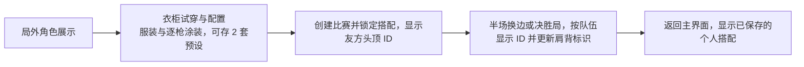

# 角色、服装与枪皮

[返回策划总览](../README.md) · [游戏术语表](../00-全局设计/游戏术语表.md)

> **模块定位与设计目的**：本模块规定角色外观的换装粒度、友方头顶 ID 规则、掉枪涂装归属以及异常保护机制。（注：当前阶段仅定义系统逻辑与规则边界，**具体服装造型、配色纹样与衣柜 UI 排版留待后续美术/界面阶段细化**。）
> * **为什么做“共用身体 + 整套服装 + 独立枪皮”**：既让玩家能在第一人称（双臂袖口 + 枪身）和第三人称享受自由混搭，又避免拆分过多散件增加首测复杂度，同时确保所有人受击判定绝对一致。
> * 同款服装从侧面或背面也需要快速辨认。可见队友的头顶显示其 ID，标记跟随角色的头部与蹲伏姿态。

---

## 一、外观层级与首测内容规格

| 外观层级 | 首测包含内容 | 换装单位与系统约束 |
| :--- | :--- | :--- |
| **基础角色** | 1 名共用二次元基础角色 | 固定身高、骨架、动作与受击判定体，场上 10 个席位共用同一基准模型；数据目录预留角色 ID 扩展字段。 |
| **友方头顶 ID** | 每名存活队友使用自己的 ID | 标记对队友可见。敌方、自身第一人称及完全遮挡的角色不显示。 |
| **阵营肩背标识** | 攻方与守方各 1 套统一标识位 | 当角色背身或距离较远时，通过胸前、双肩与上背区域的统一阵营标识区分敌我（具体图形与用色待美术定稿）。 |
| **服装** | 2 套示范整套服装（默认服装 + 替换服装） | 每次**整套替换**（同步变更上衣、下装、鞋、手套及第一人称双臂/袖口）。两套服装共用同一骨骼与动作，不改变碰撞体积。 |
| **枪械涂装** | 12 把枪各带原厂外观；首测选取代表性主战枪「白隼-12S」「炽焰-47」「折线-44」各另配 1 款替换涂装 | **每个枪型独立选配 1 款涂装**；仅替换外观表现，枪身结构、开镜视野、射击时刻与枪声完全沿用原枪。 |
| **收藏预设位** | 2 个本地搭配预设槽 | 每个预设同时记录「1 套服装 + 全部 12 把枪的涂装选择」，任意跨主题混搭均可保存。 |

> **首测发放规则**：新建本地档案默认直接拥有上述全部服装与枪械涂装（初始默认穿戴第一套基础服装、全枪原厂外观），方便玩家首次打开衣柜即可测试任意混搭。首测共提供 **3 款替换涂装**（「白隼-12S」× 1、「炽焰-47」× 1、「折线-44」× 1），覆盖守方初始手枪与攻守双方主力步枪，足以验证"首发枪绑定涂装"与"捡对方专属枪继承涂装"两条核心流程。**持有权与当前穿戴状态分开存储**，战斗内商店购买只决定当局拿到哪把枪，不收费解锁外观。长期解锁与商业化节奏留待核心玩法验证后评审。

---

## 二、从衣柜到对局的完整流转规则

### 1. 展示偏好与实战强制规则的隔离

* **个人展示阶段**  局外可旋转角色，试穿服装并切换第一、第三人称预览。
* **试穿与保存**：预览试穿仅改变临时视图，返回放弃时保留原搭配；点击应用后写入当前生效搭配，也可保存或覆盖至本地预设 1 / 2。
* **实战锁定与换边同步**  创建比赛时锁定搭配。头顶 ID 按队伍关系显示，观战沿用存活队友的视角。半场和决胜局换边时更新肩背标识。

### 2. 同一把枪的涂装生命周期（捡枪与观战规则）

| 实战场景 | 系统必须呈现的正确结果 |
| :--- | :--- |
| **1. 个人混搭入局** | 玩家穿默认服装、给「炽焰-47」配替换涂装、「街头-20」留原厂：第一人称持步枪时显示「默认服装袖口 + 替换涂装炽焰-47」，切手枪时显示「原厂街头-20」，第三人称队友看到玩家穿默认服装。 |
| **2. 阵亡掉枪与他人拾取** | 玩家掉落带替换涂装的「炽焰-47」，另一名穿着不同服装的守方 Bot 捡起该枪：地上的枪、该 Bot 手持的枪、以及观战该 Bot 时的第一人称画面，**枪身仍保留玩家的替换涂装，但握枪的双手袖口与手套始终属于当前持枪者（该 Bot）**。 |
| **3. 拾获枪械跨局保留** | 捡到这把枪的守方 Bot 存活到下一局：它带入新回合的这把「炽焰-47」**继续保留捡来的原涂装**；直到它之后自己花钱重新购买己方步枪时，才按该 Bot 入场时自带的涂装配置生成新枪。 |
| **4. 半场换边切换身份** | 角色保留服装与队友 ID，肩背阵营标识随攻守职责切换。 |

* **Bot 外观分配**：Bot 从本地已通过验证的搭配池中按席位分配服装与枪皮（允许队内或两队重样，两边都能穿任意一款服装），与玩家自己的本地衣柜档案相互独立。

---

## 三、公平性约束与异常回退保护

### 1. 公平性底线（所有外观必须遵守）

* **数值与判定零影响**：任何服装、发型与枪皮都不改变角色受击判定盒、头部范围、第一人称视野、Bot 视觉检测点、准星对齐、开火闪光时刻以及枪声传播参数。
* **识别与可见度要求**：所有宽摆/附属结构必须收束在基准轮廓内；所有服装在地图暗处仍需保证头肩轮廓与朝向可读，不得包含隔墙或穿烟可见的自发光元素；第一人称双臂与枪身在换弹、开镜、切枪、投掷与交互时不得遮挡中心瞄准区。

### 2. 异常存档与数据回退规则

* 本地档案独立保存：物品持有清单、当前穿戴搭配及 2 个预设槽。
* 所有物品使用稳定的配置 ID 关联角色、枪型、第一/第三人称表现与标识位。
* **单槽保护回退**：当某一配置中的某个物品 ID 缺失、未持有或错配了枪型（例如将手枪皮填到了步枪槽）时，**仅该异常槽位自动回退为默认基础款**，其余正常槽位保持玩家原有搭配，本地比赛可正常启动而不报错崩溃。

---

## 四、外观系统逻辑验收条件

| 验收项目 | 测试操作与通过标准 |
| :--- | :--- |
| **真混搭与本地持久化** | 遍历 2 服装 × 2「白隼-12S」替换涂装 × 2「炽焰-47」替换涂装共 8 种组合，全部可应用保存；重启游戏后自动恢复最后一次生效的搭配；试穿后取消能完整保留原搭配。 |
| **掉枪、拾枪与观战一致** | 一把带替换涂装的「炽焰-47」依次经历“本人持枪 → 阵亡掉落 → 守方拾取 → 观战该持枪者 → 存活带入下一局”全流程，枪身涂装始终一致，且第一人称手套/袖口始终归属当前持枪者。 |
| **数值与判定绝对公平** | 保持相同位置、姿态、输入与随机种子，更换不同服装与枪皮后，逐发命中判定、单发伤害、弹药数、声音事件与可射时刻必须 100% 完全一致。 |
| **友方 ID 识别** | 同款角色分别侧身、背身和蹲伏，友方头顶 ID 跟随头部。检查敌方、完整遮挡、阵亡、自身视角、观战以及换边。 |
| **敌我辨识可达标** | 在首图明暗不同区域及 10 / 20 / 30 米距离下，对穿同款服装的攻守双方（含正、侧、背面）进行盲测识别，每套服装的敌我辨识正确率目标 **≥90%**。 |
| **异常存档单槽回退** | 人为破坏某套预设中「炽焰-47」的涂装 ID，读档并开赛：服装、「白隼-12S」及其他槽位保持原搭配不变，「炽焰-47」自动回退为原厂外观，整场对局正常运转。 |
