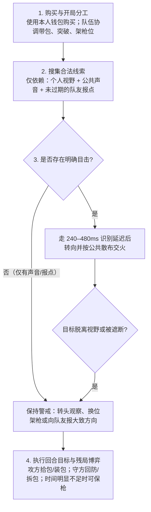

# 拟人 Bot 与单场学习

[返回策划总览](../README.md) · [道具与信息](../02-战斗/道具与信息.md) · [游戏术语表](../00-全局设计/游戏术语表.md)

> **模块定位与设计目的**：本模块规定 9 名 Bot（4 友 + 5 敌）如何像真人一样依托“所见所闻”参与拆弹对抗，以及高难度下的自动调节与单场学习规则。
> * **为什么确立“公平知觉下限”**：传统的 AI 往往靠“知道玩家坐标 + 调整反应和枪法精度”来控制难度，极易让玩家产生“它透视/锁头”的挫败感。本作所有难度的 Bot 都只能靠合法视野和公共声音打游戏，**玩家倒下后复盘一定能找到因果（“它刚好先听见了我”或“它正在架这个路口”）**。
> * **为什么高难度强在“配合与记路线”而不是“秒杀”**：难度差异体现在队友收到报点后愿不愿意支援、进点时配不配合丢道具，以及挑战难度会不会记住你前几局反复走的套路并提前布防。

---

## 一、一名 Bot 在单局内的决策循环

* **团队协作与行动偏好**：
  * 开赛时，每个 Bot 席位会从「**主动带头**」「**偏好同行**」「**倾向留守**」中分配一个行动偏好（确保双方队伍中既有敢带头的人，也有愿意同行的人）。偏好只在多个合理战术任务之间做优先级排序，不会让 Bot 无视局势死板站桩。
  * **玩家是团队一员**：玩家持有目标包时，至少 1 名友方 Bot 会主动尝试跟随保护；当玩家阵亡、掉包或发出新的集合标记时，友方自动重新分配任务。
* **任务防抖与卡死脱困**：
  * **拾包逻辑**：需要捡包时，由当时能到达且距离最近的友方认领，其余队友继续各自任务，避免全队扎堆捡包。
  * **核心任务防干扰**：正在带包的攻方与正在按住拆除的守方，不会因为远处传来一条普通脚步声就中途放弃任务乱跑。
  * **卡死兜底**：若某名 Bot 沿当前路径连续 **2 秒** 没有移动进展，立即重新规划可达路径或向队友转交当前任务，保证一名 Bot 卡住不会拖垮整队节奏。

---

## 二、公平知觉与操作下限（全难度铁律）

无论选择休闲、标准还是挑战，无论自动难度如何升降，以下 **6 条拟人约束** 在任何时刻都不得被突破：

| 公平约束环节 | 全难度强制执行的规则与限制 |
| :--- | :--- |
| **1. 视觉判定** | 水平视野固定 **100°**。从当前角色视点射线检测敌人头肩、躯干等基准部位；硬遮挡、完整烟幕与致盲效果**彻底阻断视觉**。衣饰边缘、玩家自由相机视角以及未看见的敌方导航目标均不算目击。 |
| **2. 听觉线索** | 完全复用公共声音传播与隔墙衰减规则。听见脚步只生成「大致区域 + 方向 + 时间戳」，失去新声音证据 **3 秒后过期**。回声片的前三声假脚步提供与真脚步完全相同的线索类型。 |
| **3. 队伍报点** | 目击敌人后生成「地名 + 人数 + 时间」，经过 **0.45–0.9 秒** 通信延迟送达队友，自产生起 **4 秒后过期**。若报点者在送达前阵亡，未发出的报告直接取消。接收队友只能据此转头观察或移动，**开枪前仍必须亲眼看见目标**。 |
| **4. 识别与抬枪延迟** | 从目标首次持续进入视野到针对该目标开出第一枪，**全难度至少间隔 240 毫秒**（每次新接触从 **240–480 毫秒** 区间内抽取识别延迟）。哪怕提前预瞄着入口，目标出现后依然要等识别延迟走完才能开火；若中途完全丢失视线再重新出现，**重新计时**。 |
| **5. 转向与瞄准误差** | 角色视角必须连续转动，交火时转向速度上限为 **240°/秒**（禁止瞬间回头锁头）。首次落点瞄向可见身体部位附近并带 **0.6°–2.0° 初始角误差**，随后随时间逐步修正；开火完全复用玩家同款弹道与散布，自然存在跟丢、打偏与偶然爆头的可能。 |
| **6. 失去目标后处理** | 目标进入烟幕或掩体后，**立刻停止用敌人实时位置修正准星**，并取消尚未打出的后续连发子弹。Bot 只可在最后目击处短暂停留警戒或转移观察；烟幕后敌人换向移动时，除非产生新的声音或目击线索，否则 Bot 意图不得随之改变。 |

> **多目标切换规则**：同屏出现多名敌人时，Bot 按可见威胁度与当前任务选择一个固定目标，切换目标同样走完整的识别延迟与连续转向，禁止每帧自动跳到距离准星最近的敌人头上。调试日志会完整记录每发开火的线索来源、产生时间、可见部位、首发时间与瞄准角变化，供赛后核查是否违规。

---

## 三、自动难度怎样变化（只调团队协作，不改枪法作弊）

* **开关与边界**：开局可选「休闲 / 标准 / 挑战」作为基准档，自动调节默认开启（也可手动关闭）。友方 Bot 始终保持玩家所选的基准档，**只有敌方 Bot 会在基准档允许的上下各 1 档范围内动态调整「团队协作档」**（且总上下界锁死在休闲与挑战之间）。
* **调整的是什么**：自动调节**绝不改变** 240ms 反应下限、视野、误差、枪械伤害或经济收入，只改变下表两项团队协作概率：

| 协作档位 | 收到可靠报点后，最近支援队友愿意改换任务赶来支援的概率 | 自己带有可用道具且队友准备进点时，按计划配合投掷的概率 |
| :--- | ---: | ---: |
| **休闲** | 35% | 30% |
| **标准** | 55% | 50% |
| **挑战** | 75% | 70% |

* **升降档触发条件（防情绪化波动）**：
  1. **统计样本**：每 **3 个完整回合** 构成一个评估窗口。窗口内**仅统计人类玩家亲身参与、双方先后实际互相看见并由一方击倒另一方的「有效交火」**（玩家击倒对手计胜，被该对手击倒计负；各自脱离或由第三人击倒均跳过不计）。单个窗口内必须累积 **至少 3 次** 有效交火才算有效样本。
  2. **升档 / 降档条件**：必须**连续两个不重叠的窗口**满足同一方向——两个窗口玩家胜率均 **≥70%**，敌方下一局协作**升一档**；两个窗口玩家胜率均 **≤30%**，敌方下一局协作**降一档**。
  3. **重置条件**：一旦出现样本不足、两个窗口方向相反、胜率处于 30%–70% 中间区间，或者触发过一次调档，连续计数立即清零；**半场换边时清空未完成的窗口计数**；第 25 局决胜局直接沿用当前协作档。
* **信息隔离与通知**：触发调档时，仅在下一局购买阶段提示「团队配合已从标准调至挑战」，**不会实时显示玩家交火评分**。比赛总比分、当前残局输赢或玩家刚打出一波爆头，都不能直接触发即时调档；调节器在回合内不向敌方 Bot 泄露任何玩家个人表现明细。

---

## 四、挑战难度的“单场学习”机制

仅当玩家开局选择 **「挑战」** 基准难度时，敌方 Bot 才启用单场学习（与自动调节开关相互独立）。学习系统**不建立玩家个人瞄准模型**，首版只回答一个问题：**“对手开局常从哪一条路出现？”**

| 学习环节 | 具体执行规则 |
| :--- | :--- |
| **1. 合法取样** | 仅统计争夺阶段开始后的**前 20 秒（开局窗口）**，且每个回合、每种攻守职责最多只记 **1 票**——即该局**第一次可定位的有效目击**（或由该次目击生成并成功送达的报点）。两人同时看到同一事件也只算 1 票。**仅凭脚步声、未确认的路线、或整段开局未遇敌的回合，均不计票。** |
| **2. 形成路线倾向** | 检查对手当前攻/守职责下**最近 5 个已打回合**：其中必须有 **至少 4 局** 产生了有效开局样本，且同一区域在有效样本中的占比 **≥75%**，才判定形成“常走某路”的倾向。 |
| **3. 影响下一局布防** | 形成倾向后，下一局最多抽调 **1 名可调动的开局观察者**，以 **60% 概率** 指派其提前留意该区域（另 **40% 概率** 仍按队伍原计划行动，避免死板可被轻易反抓）；若原计划本就安排它看守此处，则继续执行原计划。即便提前架枪，交火仍须亲眼确认并走 240ms 识别延迟。 |
| **4. 滚动修正与遗忘** | 每局结束滚动重算一次：一旦有效样本跌破 4 局或同区占比跌破 75%，立即撤销额外指派，恢复原队伍计划。**半场换边后，改读新职责对应的独立记录库**（攻防样本互不污染）。整场比赛结束后记忆全部清空，绝不写入本地存档。 |

### 五局学习演练例子

假设玩家开局先当攻方，打高难度「挑战」模式：
1. **第 1–4 局**：敌方在开局前 20 秒依次合法目击到攻方从 **「展廊 → 展廊 → 后台 → 展廊」** 出现。第 4 局结束后，有效样本共 4 局，其中「展廊」占 **3/4（75%）**，正式达到形成倾向的门槛。
2. **第 5 局**：敌方有较大概率（60%）在开局额外派 1 名可调动成员留意展廊方向。这一局玩家决定变招，全队走中路「导播厅」并被目击。
3. **第 5 局结束后**：最近 5 局样本变为「展廊 3 / 后台 1 / 导播厅 1」，展廊占比跌至 **3/5（60%）＜ 75%**，系统在第 6 局自动撤销对展廊的额外防备。
4. **补充反欺骗情况**：如果第 5 局你在展廊只扔了一枚「回声片」骗出假脚步，自己静步转去导播厅且双方在 20 秒内未互见，那么由于回声片不算合法目击，敌方样本依然停留在第 1–4 局的 3/4，直到旧样本滑出最近 5 局窗口为止——绝不会因为假脚步或回合中后期的转点把历史记忆变成实时透视坐标。

> **赛后可解释复盘**：赛后复盘界面可展开「对手观察」明细，清晰列出每局目击地名、有效样本计数与受影响的下一局任务；并且把「协作自动调档」与「路线习惯学习」分开呈现，让玩家一眼分清自己感受到的变强究竟来自队友协作还是习惯被抓。
