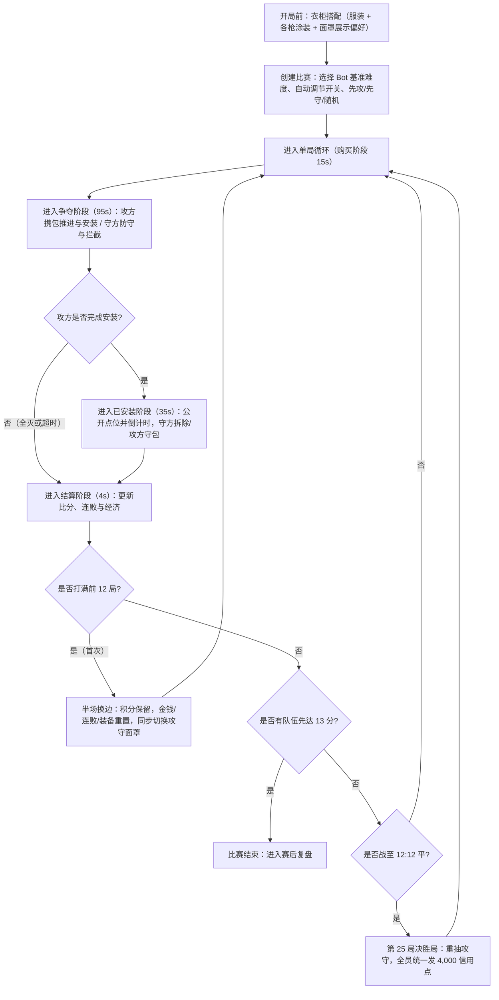

# AnimeCS 游戏策划案

> **文档定位**：v0.1 评审稿 · 目标平台为 PC 键鼠。
> **当前阶段说明**：本阶段仅定义核心玩法规则、数值基准、系统边界与验收条件，**暂不包含美术资源规格、具体造型样式与 UI 界面排版描述**。文中标为「首测」的数值均为可调整的设计起点，实际手感与平衡需通过后续试玩验证。

---

## 一、项目概述

* **项目名称**：AnimeCS（暂定名）
* **项目类型**：二次元风格 · 5v5 攻守拆弹战术射击（本地人机对局版）
* **目标受众**：喜爱经典攻守爆破（如 CS / 无畏契约）的战术射击玩家，以及偏好二次元角色搭配、希望在无联机压力下体验拟人战术对抗的玩家。
* **一句话体验**：玩家先在衣柜为自己的二次元角色挑选服装与枪械涂装，再与 4 名友方 Bot 并肩作战，和 5 名行为拟真的敌方 Bot 打完一场 5v5 拆弹比赛。交火节奏紧凑（往往在 0.25 秒内分出胜负），玩家既能看懂自己为何被发现、为何落败，也能在几局后察觉对手开始针对自己反复使用的路线。

---

## 二、整局核心流程

1. **战前准备（局外衣柜）**：玩家从已拥有的服装与枪械涂装中进行混搭，并保存个人常用预设；也可在展示界面自由预览角色摘戴面罩的效果。
2. **开局配置**：选择本场 Bot 的基准难度（休闲 / 标准 / 挑战）、是否开启自动难度调节，以及玩家首发阵营（攻方 / 守方 / 随机）。
3. **回合对抗（先赢 13 局）**：
   * 每局由 **购买（15 秒）→ 争夺（95 秒）→ [可选] 已安装（35 秒）→ 结算（4 秒）** 组成。
   * 攻方携带唯一的目标包前往 A 或 B 点安装；守方阻止安装或在安装后完成拆除。
   * 打完前 12 局后双方换边；若战至 12∶12，则加赛第 25 局等额预算决胜局。
4. **赛后复盘**：查看本场数据、Bot 的难度调档记录与高难度下的对手路线观察摘要，验证每场对抗的因果逻辑。

---

## 三、核心设计亮点与目的

| 设计方向 | 首测方案要点 | 设计目的（给玩家什么体验） |
| :--- | :--- | :--- |
| **CS2 急停手感与分阵营枪池** | 12 把枪械（含攻守专属与通用手枪/冲锋枪/步枪/狙击枪）、CS2 对标伤害与穿甲率；速度阈值急停 + 停稳固定弹道（简化压枪） | 保留玩家熟悉的急停控枪与「炽焰-47 一枪头 / 长镜-96 打身秒杀」短 TTK 博弈，同时简化压枪降低上手门槛，鼓励急停瞄准而非无脑跑打。 |
| **单道具槽的团队取舍** | 每人仅 1 个道具槽，在烟幕、闪光、回声片（假脚步）中三选一，双方同价 | 用极低的学习门槛制造明确的战前决策：自己带假脚步骗人，就意味着过点必须依赖队友补烟。 |
| **服装与枪皮的公平混搭** | 1 名共用基础角色 + 整套服装 + 逐枪涂装；攻方遮面、守方露面，另有统一肩背标识 | 满足玩家“第一人称看袖口配枪皮、掉落后别人捡起也能认出我的枪”的个性体验，同时保证受击体积与敌我识别绝对公平。 |
| **公平拟人的单场学习 Bot** | 全难度共用 ≥240ms 反应下限与视听遮挡法则；自动难度仅调协作；挑战难度单场记路线 | 杜绝传统 Bot“隔墙透视、瞬间锁头”的挫败感。玩家能靠静步、烟幕和回声片骗过对手，高难度则会记下你的常走路线并提前布防。 |
| **纯本地闭环与联机预留** | 全流程单机运行，代码架构按「席位意图—统一裁定—分权限下发」三层切分 | 首期无需网络服务即可完整试玩整场 5v5，同时为未来接入联机对战保留干净的架构边界。 |

---

## 四、本期范围约定

* **本期包含**：本地 5v5 攻守拆弹完整规则、1 张首图灰盒结构、12 把分阵营与通用枪械、1 种护甲、3 种投掷道具、2 套示范服装与部分枪皮的归属逻辑、拟人 Bot 公平边界与单场学习逻辑、全套可验证测试用例。
* **本期明确不做**：角色主动/被动技能、局外长期数值养成或解锁经济、皮肤交易、多张地图与额外娱乐模式、在线匹配与网络服务器、具体美术资产与 UI 界面设计稿。

---

## 五、文档导航

### 按系统模块阅读

* **全局约定**：[二 · 游戏术语表](00-全局设计/游戏术语表.md) · [三 · 系统清单](00-全局设计/系统清单.md)
* **比赛与地图**：[赛制、回合与首图](01-比赛/赛制与首图.md)
* **战斗与经济**：[枪械与交火](02-战斗/枪械与交火.md) · [经济与购买](02-战斗/经济与购买.md) · [道具与信息](02-战斗/道具与信息.md)
* **角色与外观**：[角色、服装与枪皮](03-外观/角色服装与枪皮.md)
* **AI 对手**：[拟人 Bot 与单场学习](04-Bot/拟人对手与单场学习.md)
* **架构与验收**：[本地对局边界与试玩验收](05-验证/本地边界与试玩验收.md)

### 按核心评审问题快速定位

| 你最关心的问题 | 推荐阅读章节 |
| :--- | :--- |
| 整局怎么赢？落后的队伍靠什么翻盘？首图长什么样？ | [赛制、回合与首图](01-比赛/赛制与首图.md) |
| 满血带甲被几枪放倒？边跑边打有什么代价？ | [枪械与交火](02-战斗/枪械与交火.md) |
| 输掉手枪局后下一局买得起什么？枪掉了怎么继承？ | [经济与购买](02-战斗/经济与购买.md) |
| 只能带 1 个道具怎么选？假脚步怎么骗人又怎么被识破？ | [道具与信息](02-战斗/道具与信息.md) |
| 换装后自己、队友、捡枪的人各自看到什么？怎么分清敌我？ | [角色、服装与枪皮](03-外观/角色服装与枪皮.md) |
| Bot 为什么不作弊？高难度到底聪明在哪里？ | [拟人 Bot 与单场学习](04-Bot/拟人对手与单场学习.md) |
| 怎么验收整套本地闭环？以后加联机改哪里？ | [本地对局边界与试玩验收](05-验证/本地边界与试玩验收.md) |
